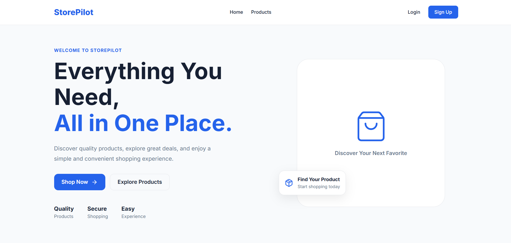
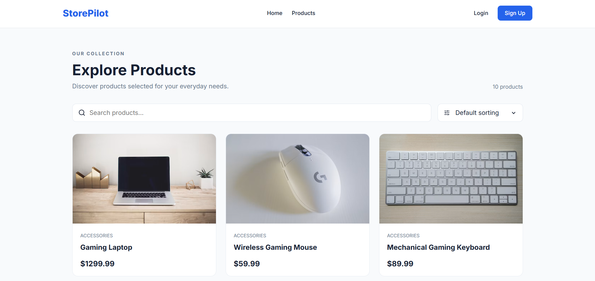
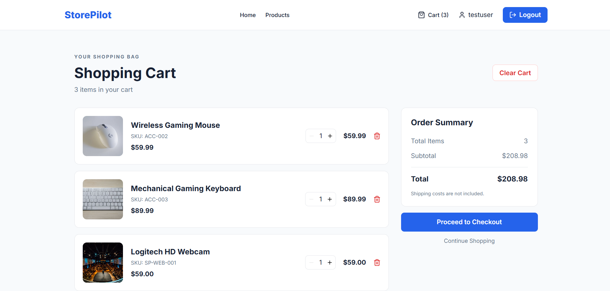
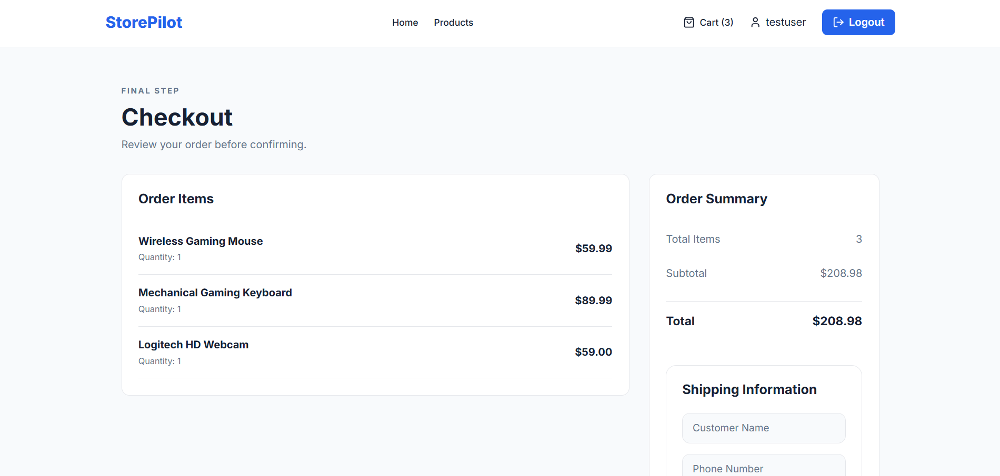
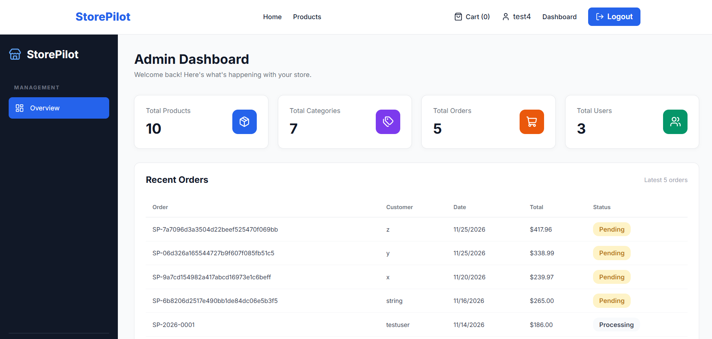

# StorePilot

A full-stack e-commerce and store management application built with React and ASP.NET Core Web API.

### Tech Stack

- **Frontend:** React, TypeScript, Vite, Axios
- **Backend:** ASP.NET Core Web API (.NET 10)
- **Database:** SQL Server, Entity Framework Core
- **Authentication:** JWT, Role-Based Authorization

### Features

- User authentication and role-based authorization.
- Product and category management.
- Shopping cart for guests and authenticated users.
- Order checkout and management.
- Admin dashboard with store overview and recent orders.
- RESTful API integration.

### Screenshots

**Home Page**



**Products Page**



**Shopping Cart**



**Checkout**



**Admin Dashboard**



### Getting Started

**Backend**

1. Configure your SQL Server connection string.
2. Configure JWT settings using .NET User Secrets.
3. Run the backend:

```bash
dotnet restore
dotnet run
```

**Frontend**

1. Navigate to the frontend directory.
2. Install dependencies and start the application:

```bash
npm install
npm run dev
```

### Author

**Sidi Abdullah**

- GitHub: [SidiAbdullah](https://github.com/SidiAbdullah)
